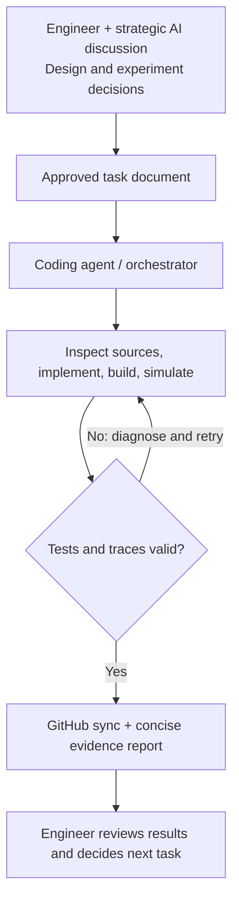

# GSAW — Initial Architecture and Workflow Idea

> **Initial proposal for discussion.** GSAW stands for **GVSoC Simulation Agentic Workflow**. The aim is a practical development workflow researchers can use with their own GVSoC projects, not a centrally maintained lab platform.

## 1. Aim

GSAW helps turn an **engineer-approved architecture or simulation task** into implemented, tested GVSoC code. The engineer focuses on design, hypotheses, and interpreting results; coding agents handle source investigation, implementation, simulation, and routine debugging.

The first version has **two pillars**:

| Pillar | Problem addressed | First-version approach |
| --- | --- | --- |
| **GVSoC knowledge base** | General coding agents may not know the correct GVSoC APIs or version-specific behavior | A `SKILL.md`-style guide pointing to local GVSoC source, official documentation, tutorials, and working examples |
| **Agentic simulation workflow** | Building and debugging simulations requires many repetitive steps | An agreed design/task file passed to a coding agent, which implements, builds, runs, validates, and reports results |

## 2. First-version workflow

### Step A — Engineering design

The engineer discusses the SoC architecture, experiment, and expected behavior with a strategic AI assistant (for example, ChatGPT Web or Claude Web). This keeps deeper design discussion separate from the coding agent's implementation context. The outcome is a short task document recording the agreed decisions, scope, and basic success checks.

### Step B — Agent implementation and simulation

A coding agent (Codex, Claude Code, OpenCode, etc.) receives the task. It should:

1. Inspect the project's source and the **installed GVSoC checkout**; consult the knowledge guide and official sources when needed.
2. Implement the agreed changes, choosing reasonable technical details itself. It may use subagents if useful; no fixed multi-agent structure is required.
3. Build and run GVSoC, inspect numerical results and relevant traces, and fix ordinary implementation errors autonomously.
4. Record what changed, which commands/tests ran, what passed or failed, and any remaining limitations.

The workflow should give the agent room to adapt. It should pause for a *material architecture or scope change*, not for every compiler error or code-level decision.

### Step C — Source synchronization and review

Use GitHub as the shared source and review point. A researcher works with their own local GVSoC installation. After successful validation, the coding agent synchronizes the project-owned source files, preserves any necessary GVSoC engine/core modifications as patches or clear instructions, and commits/pushes the authorized changes. The engineer then reviews the results and decides the next step.

This approach avoids requiring a shared lab server or complex maintenance infrastructure. Researchers can reuse the method with different coding agents and local environments.

## 3. Preliminary proof of concept

The completed **dot-product accelerator V3** gives an early example:

| Stage | What was demonstrated |
| --- | --- |
| Engineering design | Sequential MAC, custom RISC-V instruction, timing, traces, and power modeling were agreed before implementation |
| Task handoff | `V3_DESIGN_DECISION.md` recorded instructions and boundaries |
| Autonomous execution | Local agent changed GVSoC and project code, built the simulation, and debugged version-specific behavior |
| Validation and handoff | Numerical results and traces were checked; source and an ISS patch were committed to GitHub |

This shows that the basic idea is feasible, **not yet that it consistently saves time**. A first evaluation could track task completion, manual interventions, reproducibility, and time spent debugging.

## 4. Initial deliverables

1. Refine `MOCKUP_SKILLS.md` into a concise, reusable GVSoC development skill.
2. Define a simple engineer-to-coding-agent task handoff and source synchronization practice.
3. Test the workflow during development of the original SoC and AI kernel.
4. Record an example run and write a short usage guide other researchers can follow.

The first version can use existing agent tools and the GVSoC command line. It does **not** require a new GUI, custom orchestrator, or MCP server.

## 5. Bigger vision and possible extensions

If the workflow proves useful, it could grow into a researcher-operated, reusable GVSoC simulation assistant:

- **Richer knowledge retrieval:** RAG over documentation, local source, and previous validated experiments, with attention to GVSoC versions.
- **Structured tools:** MCP interfaces for building, running, retrieving logs, and inspecting traces, if repeated manual commands become a bottleneck.
- **Longer autonomous studies:** Persistent tasks and optional subagent coordination for more complex model development and simulation campaigns.
- **Better experiment tracking:** Reproducible configurations and comparisons across runs, especially for later performance or energy studies.

These are **directions to explore**, not commitments for the initial URECA scope. The immediate priority is a credible, useful workflow that supports the original SoC simulation and roofline analysis.

