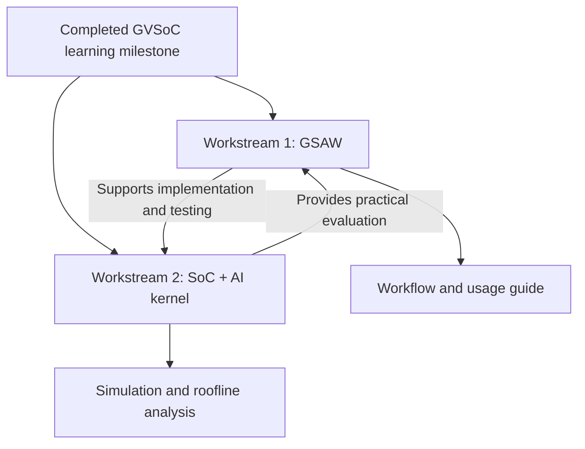

# Proposed URECA Direction: Two Complementary Workstreams

> **Discussion proposal — for supervisor feedback, not yet an approved change of scope.**

## 1. Original project and progress

The original project, *Full-Platform Simulation of a Small AI Kernel on GVSoC*, aims to:

1. Learn the GVSoC simulation framework.
2. Design and simulate a small System-on-Chip (SoC).
3. Run a small AI kernel on the simulated system.
4. Analyze performance, including a roofline-based comparison.
5. Document the development and simulation process for future users.

The foundational learning stage is now complete, including the GVSoC tutorials and a small dot-product accelerator milestone. Through this work, a recurring challenge became clear: substantial time goes into finding framework-specific APIs, adapting examples to the installed GVSoC version, building models, and debugging simulations.

## 2. Motivation for the proposed split

AI coding agents can assist with this repetitive engineering work, but they need reliable GVSoC-specific references and a clear process for implementation and testing. A preliminary trial on the dot-product accelerator used an agreed design document, a local coding agent, GVSoC builds and traces, and GitHub synchronization. It successfully implemented and validated sequential MAC, a custom CPU instruction, timing, and power modeling.

This suggests an opportunity to produce **a reusable GVSoC development method**, rather than documentation alone, while still completing the original SoC research. The trial demonstrates feasibility; its time savings and reliability have not yet been formally measured.

## 3. Proposed two workstreams

| | Workstream 1: GVSoC Simulation Agentic Workflow (GSAW) | Workstream 2: Original SoC Simulation and Analysis |
| --- | --- | --- |
| **Purpose** | Help researchers develop and run GVSoC simulations with AI assistance | Complete the originally assigned technical study |
| **Main work** | GVSoC knowledge guidance; engineer-to-agent development workflow; build, simulation, validation, and GitHub handoff | SoC design; small AI-kernel execution; performance analysis and roofline comparison |
| **Output** | Reusable workflow, source guidance, usage instructions, and a practical demonstration | Working SoC model, validated kernel results, analysis, and documentation |
| **Possible extension** | MCP/RAG if the basic workflow needs them | Architectural optimization if time permits |

The two workstreams reinforce each other: **GSAW helps carry out the SoC development, while the SoC project provides a realistic test of GSAW.** Neither replaces the other.

## 4. Scope and expected deliverables

**Core goals**

- A GVSoC-specific knowledge guide, starting from the existing `MOCKUP_SKILLS.md`.
- A practical, researcher-operated agentic workflow for design handoff, coding, simulation, debugging, and reporting.
- A demonstration of the workflow on the ongoing GVSoC project, with reproducible source changes and simulation evidence.
- Completion of the original SoC/kernel study, roofline analysis, and final usage documentation.

**Optional, only if useful and time allows:** MCP or RAG integration, more advanced agent coordination, and further SoC optimization.

The proposal does **not** aim to build a new general-purpose AI platform, invent a new agent algorithm, or fully automate architectural research decisions. The engineer remains responsible for design choices and interpreting experimental results.

## 5. Request for feedback

Would this two-workstream direction be appropriate for the remaining URECA project? If approved in principle, the next step is to refine GSAW's first version and evaluate its usefulness while progressing with the original SoC simulation and analysis.

